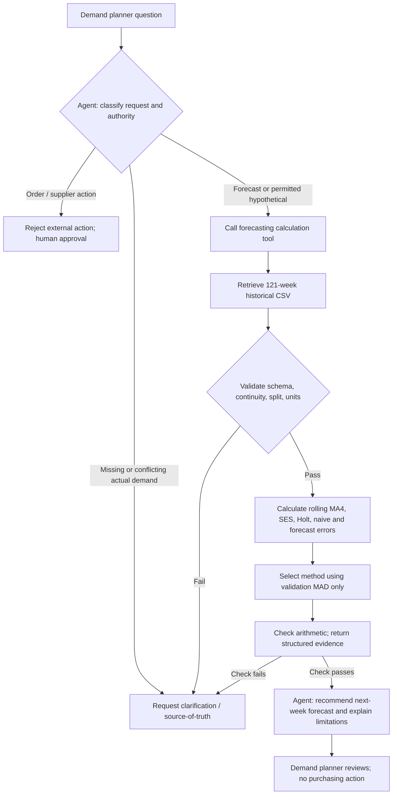

# Proposed Option B agentic architecture and decision rules

### Agent responsibility
Interpret the request, choose the forecast tool, inspect status, explain results and caveats. The agent must never invent numerical outputs or silently resolve contradictory sources. The tool makes deterministic calculations and validations; it cannot buy inventory, email suppliers, or approve expenditures.

### Status routing
- `OK`: report forecast, validation MAD and holdout metrics, and human approval boundary.
- `SIMULATED`: label scenario values clearly; preserve original CSV and baseline.
- `NEEDS_INPUT` or `NEEDS_RECONCILIATION`: ask human for missing figure or authoritative source.
- `BLOCKED`: refuse to place an order; ask for procurement approval and needed operational data.
- Tool error / unverified computation: no numeric recommendation until corrected; don't hide failures.

### Tool/knowledge evidence
`forecast_tool/engine.py` reads the original annotated data CSV, calculates model predictions sequentially with no lookahead, selects among four methods using validation MAD, and independently checks the MA4 next-week arithmetic. Exact formulas and model assumptions in `knowledge/BIA674_Midterm_Munoz_Forecasting_Method_SOP.md`.

### Next implementation stage
Publish the calculation engine through a verified MCP server/host, connect that server to an account-private plugin, record tool selection and real execution in ChatGPT, and do one evidence-driven instruction iteration and retest. No hosted MCP endpoint has been established in this environment.
